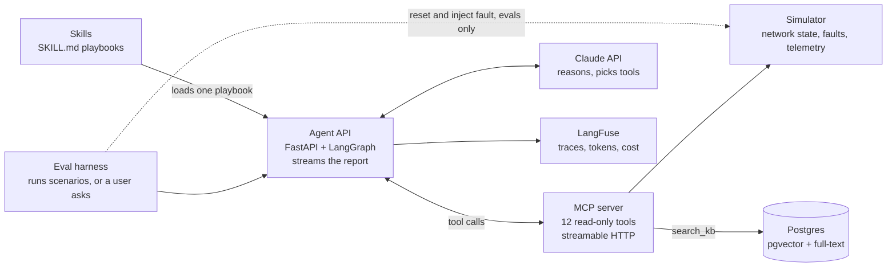
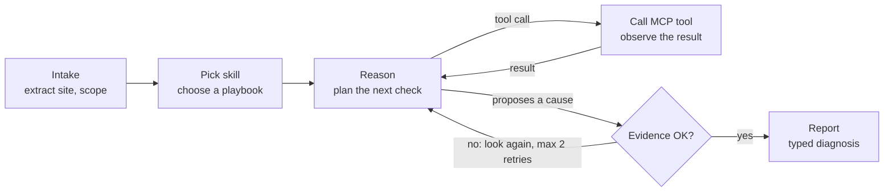

# NetMedic: project spec

_Version 1 · 2026-11-19 · Oscar_

## Overview

NetMedic is a LangGraph agent that diagnoses faults in a simulated enterprise network. It works
through tools served by an MCP server, and its accuracy is measured against faults whose root
cause is known. It is a small, honest version of what the Marvis team builds, sized for about 3
weeks of evenings.

The core idea: you inject every fault yourself, so every test scenario has a known correct answer.
That turns evaluation from opinion into a score.

**Success criteria (targets you set, not promises):**

- Root-cause accuracy of 80% or better across about 40 scenarios, each run 3 times
- No false alarms on healthy-network scenarios
- Tool calls, latency and cost tracked for every diagnosis
- One command deploys the whole system to a local Kubernetes cluster
- CI runs a smoke eval on every push and blocks a change that lowers accuracy

**How it maps to the HPE posting:**

| Posting requirement | Where NetMedic covers it |
| --- | --- |
| LangGraph, ReAct loops, self-correction | Agent graph with a verify step that sends weak conclusions back |
| MCP servers, tool schemas, server lifecycle | Network tools MCP server, versioned and deployed as a service |
| Skills and SKILL.md playbooks | One playbook per troubleshooting scenario |
| RAG, hybrid search, relevance tuning | Search over a troubleshooting knowledge base, with retrieval metrics |
| Evals for non-deterministic systems, A/B tests, LLM-as-judge | Eval harness with repeated runs and config comparisons |
| Anomaly detection, time-series | Statistical detector on simulated telemetry |
| Structured outputs, streaming, error handling | Typed diagnosis report, streamed API responses, step budgets |
| Kubernetes, Docker, CI/CD | kind cluster, image per service, GitHub Actions |
| Observability, cost tracking | LangFuse traces and Prometheus metrics |
| Networking domain knowledge | The whole problem space |

## Architecture



A request flows left to right: the agent reasons with Claude, follows one playbook, and reaches
the network only through MCP tools. Only the eval harness talks to the simulator directly, to
reset it and inject faults, and every agent step is traced in LangFuse.

## Tech stack

Everything runs in Python and on your laptop first. The AWS pieces are optional swaps for later.

| Layer | Choice | Why / later swap |
| --- | --- | --- |
| Language and tooling | Python 3.13, uv, ruff, pytest | Fast setup and a production-style codebase |
| Agent framework | LangGraph | The framework named in the posting |
| LLM | Claude through the Anthropic API | Later: the same models through AWS Bedrock |
| MCP | Official `mcp` Python SDK (FastMCP), streamable HTTP transport | HTTP lets the server run as its own service in Kubernetes |
| MCP to LangGraph bridge | `langchain-mcp-adapters` | Loads MCP tools straight into LangGraph |
| Services | FastAPI | Simulator API, agent API with streaming |
| Vector store | Postgres with pgvector, plus Postgres full-text search | You already know Postgres. Later: OpenSearch Serverless |
| Embeddings and re-ranking | A small open-source embedding model and cross-encoder, run locally | No extra API cost |
| Tracing | LangFuse, self-hosted in Docker | Traces, token counts and cost per run |
| Metrics | Prometheus client in FastAPI | Latency and error rates |
| Containers | Docker, images pushed to GitHub Container Registry | Later: Amazon ECR |
| Orchestration | kind (Kubernetes in Docker) | Later: Amazon EKS |
| CI/CD | GitHub Actions | Lint, tests, image builds, smoke evals |

## Repo structure

One repo and one installable Python package, `netmedic`, in the `src/` layout, with a subpackage
per service (`import netmedic.simulator`, `import netmedic.agent`, ...). Each service still builds
into its own container image with its own entry point. See D-008.

```
netmedic/
├── CLAUDE.md                  # instructions for Claude Code
├── pyproject.toml             # one package, built with uv_build; `netmedic` CLI entry point
├── uv.lock
├── Makefile                   # make up / make eval / make deploy
├── docker-compose.yml         # postgres+pgvector, langfuse, all services
├── docs/
│   ├── SPEC.md                # this file
│   ├── LESSONS.md             # curriculum + progress log
│   └── DECISIONS.md           # decision log
├── src/netmedic/
│   ├── __init__.py            # main(): the `netmedic` command
│   ├── simulator/
│   │   ├── topology.py        # data model: sites, switches, APs, WLANs, pools, clients
│   │   ├── generator.py       # seeded build_topology(seed)
│   │   ├── telemetry.py       # metric and event generators
│   │   ├── faults.py          # fault injectors (one class per fault)
│   │   └── api.py             # FastAPI: /state, /faults, /reset
│   ├── mcp_server/
│   │   ├── server.py          # FastMCP tools
│   │   └── schemas.py         # pydantic input/output models
│   ├── agent/
│   │   ├── graph.py           # LangGraph definition
│   │   ├── state.py           # agent state
│   │   ├── report.py          # structured diagnosis output
│   │   ├── prompts/
│   │   ├── skills/            # one folder per skill, each with SKILL.md
│   │   └── api.py             # FastAPI /diagnose with streaming
│   ├── retrieval/
│   │   ├── kb/                # troubleshooting articles (markdown)
│   │   ├── ingest.py          # chunk, embed, load
│   │   └── search.py          # hybrid search + re-rank
│   ├── detection/
│   │   └── anomaly.py         # statistical anomaly detector
│   └── evals/
│       ├── scenarios/         # one YAML file per scenario
│       ├── run_evals.py
│       ├── judge.py           # LLM-as-judge
│       └── report.py          # results table + A/B comparison
├── tests/                     # pytest; mirrors src/netmedic/ (tests/simulator/, ...)
├── reports/                   # generated eval reports (not package code)
├── deploy/
│   ├── docker/                # one Dockerfile per service
│   └── k8s/                   # manifests (or a Helm chart)
└── .github/workflows/ci.yml
```

Rule of thumb: code, and the files that code reads at runtime (prompts, skills, scenarios, KB
articles), live inside `src/netmedic/`. Generated output and deployment files live at the root.

## Network simulator

The simulator is a fake network whose state you control, so every fault has a known cause. Keep
it simple: realistic enough that symptoms point to causes, not a packet-level emulator.

**Topology (suggested size):**

- 2 sites, each with 1 core switch and 2 access switches
- 12 access points (APs), 3 Wi-Fi networks: Corp (802.1X login), Guest (password) and IoT
- 3 VLANs with their own DHCP pools, plus shared DNS and RADIUS servers
- About 150 clients (laptops, phones, IoT devices) spread across the APs

**Telemetry it produces:**

- Per AP, each simulated minute: client count, channel utilization %, noise floor (dBm), retry
  rate %, up/down
- Per client: signal strength (RSSI), signal-to-noise ratio, and connection events: associate,
  authenticate, DHCP, DNS, each with success or failure and a reason
- Per switch port: up/down, error counters, PoE power drawn, VLANs allowed
- Per DHCP pool: addresses in use out of total

**Rules that keep it useful:**

- Everything is seeded, so the same scenario produces the same data on every run. The only
  randomness in an eval run should come from the LLM.
- Normal traffic follows a daily pattern with mild noise, so the anomaly detector has a real
  baseline to learn.
- A fault is a class that changes the network state and records its ground truth: root-cause
  label, affected devices, and the evidence that proves it.
- Simulated time, not wall-clock time: a scenario fixes a seed, a fault, a start time and how long
  the fault has been active.

**Simulator API:** `POST /reset` (seed), `POST /faults` (inject), `GET /state/...` (read). Only the
MCP server talks to the simulator. The agent never sees fault labels.

## MCP server

The MCP server exposes about 12 read-only tools, each one a question a network engineer would ask.
Start with the first 6 in week 1 and add the rest as scenarios need them.

| Tool | Inputs | Returns | Week |
| --- | --- | --- | --- |
| `get_site_health` | site_id | AP up/down counts, client counts, top issues | 1 |
| `list_aps` | site_id, status? | APs with status, client count, channel | 1 |
| `get_ap_stats` | ap_id, window_minutes | Time series: clients, channel utilization, noise, retries | 1 |
| `get_client_events` | client_mac or ap_id, window_minutes, event_type? | Connection events with result and failure reason | 1 |
| `get_dhcp_pool` | vlan_id | Addresses used / total, recent failures | 1 |
| `get_switch_port` | switch_id, port | Status, errors, PoE draw, allowed VLANs | 1 |
| `get_client` | client_mac | AP, RSSI, SNR, IP, VLAN, Wi-Fi network | 2 |
| `run_ping` | source_device, target | Loss %, latency (simulated) | 2 |
| `resolve_dns` | client_mac, hostname | Result or timeout | 2 |
| `get_device_config` | device_id | Relevant config (Wi-Fi networks, VLANs, auth servers) | 2 |
| `detect_anomalies` | scope, window_minutes | Metrics outside their normal range, with scores | 2 |
| `search_kb` | query, k | Top troubleshooting passages with sources | 2 |

**Design rules:**

- **Descriptions are for the model.** Each docstring says what the tool answers and when to use
  it. Tool choice depends on these words, so they are part of what you evaluate.
- **Typed in and out.** Pydantic models for every input and output, so the JSON schema is
  generated, not hand-written.
- **Small, bounded results.** Summarize first, offer detail second (time windows, limits,
  pagination). Large dumps waste context and money.
- **Errors the model can act on.** Return `{"error": "unknown_ap", "hint": "use list_aps"}` instead
  of raising, so the agent can correct itself.
- **Read-only.** No tool changes the network. Remediation is a recommendation in the report.
- **Versioned.** The server reports a semantic version. Renaming a tool or changing a schema is a
  major version bump, and every eval report records which version it ran against.
- **Health checks.** A `/healthz` endpoint for Kubernetes probes.

## Agent design



The agent runs a ReAct loop (reason, call a tool, read the result) inside a fixed graph. A verify
step checks the proposed cause against the evidence and sends weak conclusions back for more
checks, at most twice.

**Graph state:** the complaint, extracted scope (site, VLAN, client), active skill, message history,
evidence collected (tool + finding), current hypothesis, step count, token cost.

**Verify step.** A separate, cheaper LLM call asks: does every claim in the hypothesis point to a
tool result? Does the evidence rule out the likely alternatives? If not, it returns the gap (for
example, "DNS not checked") to the Reason node.

**Structured output.** The final answer is a Pydantic model, so evals can score it and the API can
stream it:

```python
class Diagnosis(BaseModel):
    root_cause: RootCause  # enum: the 13 scenario labels
    confidence: float  # 0 to 1
    scope: list[str]  # affected sites, VLANs, APs or clients
    evidence: list[Evidence]  # tool called + the finding it returned
    remediation: list[str]  # recommended fixes, never executed
    no_fault_found: bool
```

**Error handling:**

- A step budget (start at 12 tool calls); hitting it forces a report with low confidence instead
  of looping forever
- Tool errors go back to the model as messages, so it can retry with corrected arguments
- LLM API errors retry with exponential backoff; a malformed structured output gets one repair
  attempt
- The API streams node updates as server-sent events, so a user sees each check as it happens

## Skills and RAG

Skills tell the agent how to investigate; retrieval gives it facts it doesn't have. Both are
measured, not assumed to help.

**Skills.** One folder per playbook in `agent/skills/`, starting with 4: `wifi-cannot-connect`,
`slow-wifi`, `no-internet`, `area-outage`. Each `SKILL.md` has:

- Frontmatter: `name` and a one-line `description` of when to use it
- Symptoms that point to this playbook
- Ordered checks, each naming the tool to call and what a bad result looks like
- The root causes it can conclude, and the evidence each one needs
- When to stop and say "no network fault found"

Loading works by progressive disclosure: the agent sees only names and descriptions, picks one,
and only then is the full playbook added to its context. That keeps prompts small and lets you
test skills one at a time.

**Retrieval (RAG).** Write about 25 short troubleshooting articles in `retrieval/kb/` in your own
words (DHCP, DNS, 802.1X, channel planning, PoE, VLAN trunks). Then:

1. **Chunk** by heading, a few hundred tokens per chunk, keeping the article title on each chunk.
2. **Embed** with a local open-source model and store in pgvector.
3. **Hybrid search:** run Postgres full-text (keyword) and vector search, then merge the two lists
   with reciprocal rank fusion.
4. **Re-rank** the top 20 with a local cross-encoder and return the top 5.
5. **Measure:** write 30 questions with the article that should answer each, and track recall@5
   and MRR for keyword-only, vector-only, hybrid and hybrid plus re-rank. That table is your
   "relevance tuning" story.

**Stretch: agent memory.** After each diagnosis, store a short case summary (symptoms, root cause,
evidence). On new problems, retrieve similar past cases. Then measure whether past cases improve
accuracy or just add noise.

## Fault scenarios

Thirteen fault types, each written as 3 scenarios (different site, severity and complaint wording),
give about 40 eval cases. The first three are the week 1 targets.

| Label | What breaks | What the user reports | Evidence that proves it |
| --- | --- | --- | --- |
| `dhcp_pool_exhausted` | One VLAN's DHCP pool is full | New devices on one network get no connection | Pool 100% used, DHCP timeouts on that VLAN only |
| `ap_offline_poe` | Switch PoE budget exceeded, AP loses power | Wi-Fi dead in one area | AP down, its switch port shows PoE denied |
| `dns_failure` | DNS server stops answering | Connected but no internet | DNS timeouts, ping by IP succeeds |
| `dhcp_server_down` | DHCP server unreachable | Nobody new can connect anywhere | DHCP failures across every VLAN |
| `radius_unreachable` | 802.1X auth server unreachable | Corp Wi-Fi fails, Guest works | Auth failures with timeout reason on Corp only |
| `vlan_missing_on_trunk` | Switch port missing a VLAN | One network fails on APs behind one switch | Allowed-VLAN list missing it; DHCP fails only there |
| `wrong_psk` | Bad Guest password pushed to some APs | Guest Wi-Fi fails in one building | Auth failures with bad-key reason, same AP group |
| `co_channel_interference` | Neighbouring APs on the same channel | Wi-Fi is slow | High channel utilization and retries, shared channel |
| `non_wifi_interference` | Noise source on 2.4 GHz | Slow or dropping Wi-Fi in one spot | Raised noise floor, low SNR on nearby APs |
| `ap_overloaded` | Too many clients on one AP | Slow Wi-Fi during a meeting | One AP far above its neighbours' client count |
| `uplink_errors` | Damaged cable on a switch uplink | Intermittent drops for a whole area | Rising error counters, ping loss behind that switch |
| `client_low_signal` | One user far from any AP | "My Wi-Fi is bad" (one person) | Weak RSSI for that client only, network healthy |
| `healthy` | Nothing | A vague complaint | No anomalies; the right answer is "no network fault found" |

The `healthy` and `client_low_signal` cases matter most for credibility: they test whether the
agent invents a network problem when there isn't one.

Scenario file example (`evals/scenarios/dhcp_exhausted_site2.yaml`):

```yaml
id: dhcp_exhausted_site2
seed: 42
fault: dhcp_pool_exhausted
params: {site: site-2, vlan: 10}  # Corp: laptops live on VLAN 10 (L1 layout)
active_for_minutes: 45
complaint: "People in building 2 say their laptops won't connect since this morning."
expected:
  root_cause: dhcp_pool_exhausted
  scope: [pool-2-10]
  key_evidence: [dhcp_pool_full, dhcp_timeouts]
```

## Evaluation

The eval harness is the centrepiece: it turns "the agent seems good" into numbers you can compare
between versions.

**One eval run:**

1. Reset the simulator with the scenario's seed and inject its fault.
2. Send the complaint to the agent and collect its structured report plus its LangFuse trace ID.
3. Score the report against the scenario's `expected` block.
4. Repeat each scenario 3 times, because the same input can give different answers.

**Metrics:**

| Metric | How it is measured |
| --- | --- |
| Root-cause accuracy | Report's label equals the expected label; mean and spread over the 3 runs |
| False-alarm rate | Share of `healthy` runs where the agent names a network fault |
| Evidence recall | Share of the expected key evidence the report cites |
| Consistency | Share of scenarios where all 3 runs agree |
| Tool calls and steps | Count per diagnosis, from the trace |
| Latency | Seconds per diagnosis |
| Cost | Tokens and dollars per diagnosis, from LangFuse |
| Explanation quality | LLM judge score, 1–5 |

**LLM-as-judge.** A separate model grades each explanation on a written rubric: correct cause,
claims backed by tool output, actionable fix. Before trusting it, grade 20 runs yourself and check
how often the judge agrees with you. Report that agreement rate.

**A/B tests.** A config file defines a variant (prompt version, skills on or off, tool
descriptions, model, retrieval on or off). Run two variants on the same scenarios and report the
accuracy difference with a bootstrap confidence interval. Comparing results on the same scenarios
is what makes a small sample meaningful.

**Output:** a markdown report per run (`reports/<date>-<variant>.md`) with the metrics table,
failures listed with trace links, and the MCP server and prompt versions used.

## Observability, packaging and deployment

The system ships as three containers (simulator, MCP server, agent API) plus Postgres and LangFuse,
deployable to Kubernetes with one command.

**Observability:**

- LangFuse: one trace per diagnosis, a span per graph node and tool call, token and cost totals,
  tagged with scenario ID and variant
- Prometheus `/metrics` on each FastAPI service: request count, latency histogram, tool error rate,
  agent step count
- Structured JSON logs carrying the trace ID, so a log line leads to its trace

**Containers:**

- Multi-stage Dockerfile per service, small runtime image, non-root user
- Tagged with the git commit SHA and pushed to GitHub Container Registry

**Kubernetes (kind):**

- A Deployment and Service per app service
- ConfigMap for model name, step budget and MCP server URL; Secret for the API key
- Readiness and liveness probes on `/healthz`
- CPU and memory requests and limits on every container
- `make deploy` creates the cluster, loads images and applies manifests

**CI (GitHub Actions), on every push:**

1. ruff and unit tests (simulator, tools, scoring)
2. Build and tag images
3. Smoke eval: 10 scenarios, 1 run each, fail the build if accuracy drops more than 10 points below
   the stored baseline
4. Upload the eval report as a build artifact

Run the full eval (40 scenarios × 3) by hand or nightly, since it costs API money.

**Optional AWS version:** EKS or ECS Fargate for the services, Bedrock for the model, OpenSearch
Serverless instead of pgvector, ECR instead of GHCR. Same code, different config.

## Milestones

| Week | Focus | Deliverables | Gate |
| --- | --- | --- | --- |
| 1 | Core loop | Simulator with 3 faults; MCP server, first 6 tools; basic LangGraph ReAct agent; CLI (complaint in, report out) | **Gate 1 (stop point if needed):** solves 3 faults from the CLI |
| 2 | Measure | 40 scenarios and eval harness; LangFuse tracing; 4 skills and the verify step; knowledge base with hybrid search | **Gate 2:** baseline report + one A/B result |
| 3 | Ship | Dockerfiles and kind deploy; metrics and health probes; GitHub Actions with smoke evals; README with diagram and results | **Gate 3:** one-command deploy, CI gates evals |
| Stretch | | AWS (EKS, Bedrock, OpenSearch), agent memory, sandboxed code execution | |

Each week ends at a gate you can show someone. If the HPE process moves fast, Gate 1 alone gives
you a real agent, MCP server and skills to talk about. Push to GitHub from day one, so the commit
history shows how the project grew.

## Interview talking points and README

What you can say about the project depends on the numbers you actually get. Fill these in from your
eval reports.

**Talking points to prepare:**

- Why injected faults: ground truth makes non-deterministic output measurable
- One design decision the evals changed, with before and after numbers (for example, a rewritten
  tool description or a new skill)
- A failure you found in a trace and how you fixed it (wrong tool, looping, invented evidence)
- How the agent avoids false alarms on a healthy network, and its false-alarm rate
- Retrieval: which search setup won on recall@5, and by how much
- Cost per diagnosis, and one change that lowered it
- When you would fine-tune instead of using retrieval or prompts (for this problem: probably not,
  and why)
- How you would scale from 12 simulated APs to a real Mist deployment

**README checklist:**

- [ ] One-paragraph summary and a demo GIF or short video
- [ ] Architecture diagram
- [ ] Results table from the latest full eval run, with the date
- [ ] One A/B result and what it taught you
- [ ] Quick start: `make up`, `make eval`, `make deploy`
- [ ] Design decisions and known limitations
- [ ] Link to a sample LangFuse trace (screenshot if the instance is local)
